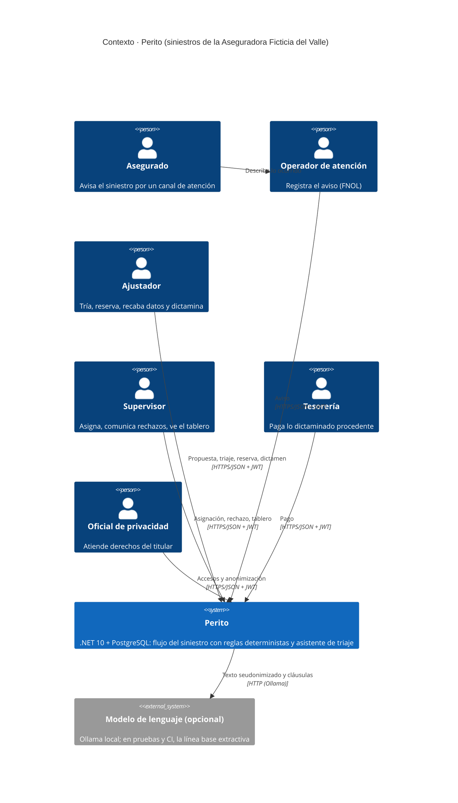
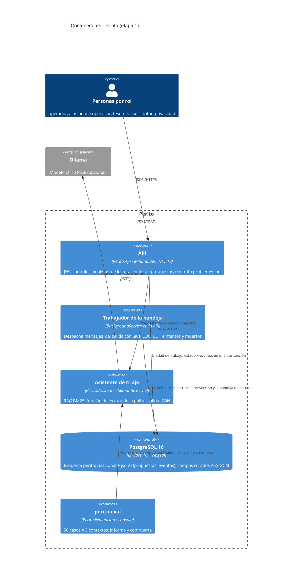
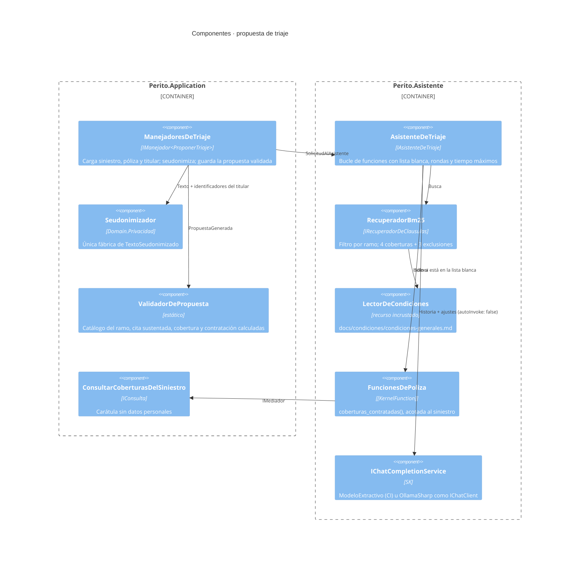
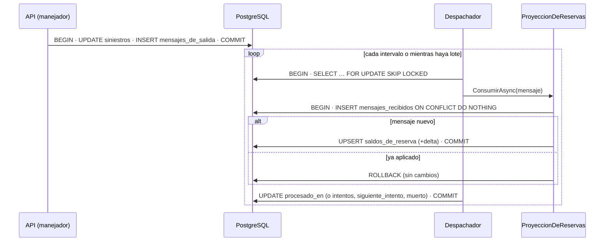

# Arquitectura · Perito

Modelo C4 en tres niveles (contexto, contenedores y componentes del asistente) y la secuencia de la bandeja de
salida. Los diagramas son texto (Mermaid) y describen lo que hay en el código de la etapa 1, no un plan. Las
decisiones están en [`docs/adr/`](../adr) y las reglas con su prueba en [`docs/reglas.md`](../reglas.md).

## 1. Contexto

## 2. Contenedores

## 3. Componentes del asistente

## 4. Capas (las hacen cumplir `tests/Perito.Architecture.Tests`)

| Proyecto | Depende de | Contiene |
|---|---|---|
| `Perito.Domain` | sólo la BCL | agregados, máquina de estados, cálculo, catálogo del producto, eventos, `IClock`, seudonimizador |
| `Perito.Application` | Domain | casos de uso, puertos, mediador propio, `IComando`/`IConsulta`, validador de propuestas |
| `Perito.Infrastructure` | Application | EF Core + Npgsql, almacén y unidad de trabajo, bandeja de salida y de entrada, cifrado, registro de accesos, `SystemClock` |
| `Perito.Asistente` | Application | Semantic Kernel, RAG, función de la póliza, proveedores |
| `Perito.Api` | Infrastructure, Asistente | composición, rutas, JWT, trabajador |
| `Perito.EnMemoria`, `Perito.Evaluacion` | Application, Asistente | adaptadores en memoria y la evaluación |

## 5. Bandeja de salida (ADR 0003)

